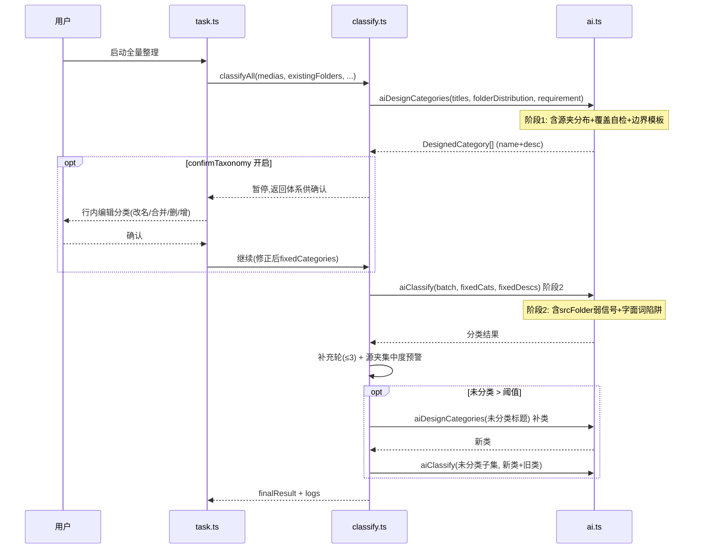
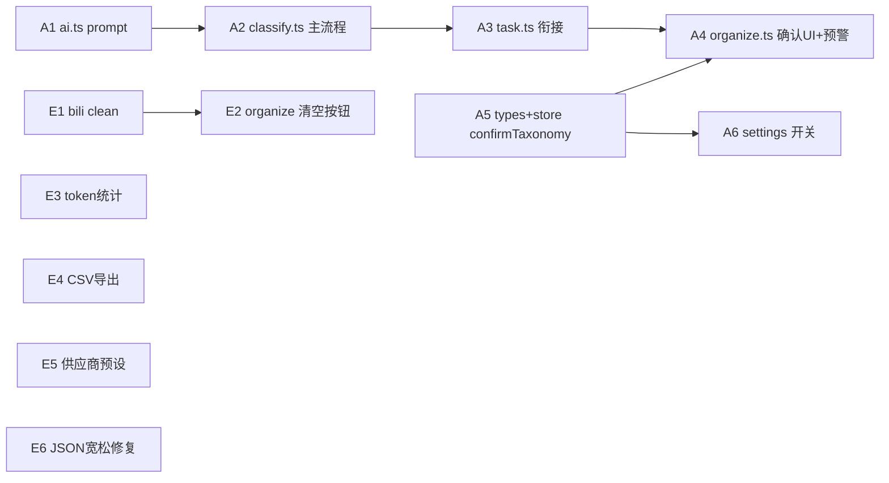

# AI分类逻辑优化 + 全脚本审查报告

> 审查范围：全脚本 AI 分类逻辑优化（重点）+ 全脚本多角度审查（竞品/安全/健壮性/可维护性）
> 核心审查输入：`F:\Downloads\分类预览-2026-08-22.md`（2026-08-23 02:35，全量重分类，17 类 / 566 条 / 未分类 50）
> 审查人：架构师 Bob ｜ 日期：2026-08-23
> 硬约束：单文件油猴·全内联零依赖·数据向后兼容·不重复推荐 v0.8.0 已修的 S1/B1-B5·不重复推荐规则编辑报告内容·不推荐复盘已否决方案（启发式截词/候选名池>6/70条硬阈值）

---

## 一、本次分类预览问题分析（核实+扩展）

> 方法：逐条对照 MD 中每条视频的「来自 XXX」（srcFolderName 原始来源夹）与归入的分类，统计错分模式。
> 核实结论：主理人 7 大问题模式**全部准确**；另补充 6 条遗漏错分模式（标 ➕）。

### 1.1 数据反推核实（含源夹分布统计）

| # | 问题模式 | 数据证据（MD 逐条统计） | 核实 |
|---|---------|------------------------|------|
| 1 | 未分类 50 条几乎全来自"社会纪实"原夹 | 未分类(50) 条目逐条核对，「来自 社会纪实」×50，**100% 来自社会纪实夹**。17 类体系中无"社会时事/纪实"主题，整夹无类可归 | ✓ 准确 |
| 2 | 历史政治 73 条半垃圾桶 | 历史政治(73) 源夹分布：历史政治≈35、社会纪实≈12、职业就业≈6、生活科普≈8、游戏娱乐×1（"和AI玩历史猜人物游戏"，按标题"历史"字面归）、手工DIY×1。混入生活科普的"法国人实测中国外骨骼""人类逐渐发现猫是代码动物""在2000多米高空建会飞的发电站""绝育和避孕延长脊椎动物寿命""追踪全球3万名顶尖精英""SM快感原理大揭秘"等，均为科技/生物/社科内容按表面词误归 | ✓ 准确 |
| 3 | 编程开发 35 条混入 9 条求职内容 | 编程开发(35) 中「来自 职业就业」×9："如果当初我在学计算机之前就知道这些""为啥永远Linux C/C++""全程借助AI找项目写代码""代码能力差怎么练""如何评价阿里笔试禁本地IDE""25届一本Gap""基于混子导向的技术岗速成实习路线""2026年IT学生别再只问学习路线""主生产计划编制" | ✓ 准确（且"主生产计划编制"是 ERP 生产计划，与编程完全无关，纯标题"生产"误配） |
| 4 | AI编程 37 条混入非编程 | AI编程(37) 中错分：「来自 职业就业」×3（李飞飞10年后只有两种工作、改变视频行业的AI、Deepseek大模型面试感受——AI 对就业影响/面试，非编程）；「来自 AI编程」但内容错："爆改男粉丝(教学版)"（爆改/lifestyle）、"关于笔记写作的原理"（写作方法论）、"如何借助智能体迭代笔记"（笔记法）、"关于AI的深度研究:ChatGPT正在产生心智吗"（AI哲学）、"AI第一次造出自然界不存在的病毒"（AI科学应用）——按"AI/智能体"表面词命中即归 | ✓ 准确 |
| 5 | 生活科普 47 条杂烩 | 生活科普(47) 混入：百度网盘限速(来自编程开发)、租房(来自职业就业×2)、猫狗剃毛(来自手工DIY)、18岁肠内息肉手术(来自社会纪实,医疗新闻非科普)、慢性压力/拖延症/颜值焦虑(来自情感社交×5)、男士内裤推荐+央视曝光劣质牙刷(来自美食烹饪×2)、美国女生痛斥白左女权(政治评论)、法国人实测外骨骼(科技工业)。阶段1 缺"生活好物/评测"类，缺"个人成长/心理"类 | ✓ 准确 |
| 6 | 数据算法(6)/AI编程(37)/编程开发(35) 边界模糊 | 数据算法仅 6 条且含"全球首个脊椎动物数字脑"（生物，按"数字"字面误归）；三个技术类在阶段1 未给边界定义，"AI编程"成了含"AI"字标题的收容所 | ✓ 准确 |
| 7 | 来源信息未被利用 | `classify.ts:42-51` `toAiVideos` 只映射 id/bvid/type/title/intro(30字)/upper，**未传 srcFolderName**；`ai.ts:136-184` `aiDesignCategories` 只接收 `allTitles`，无源夹信息 | ✓ 准确 |

### 1.2 补充遗漏的错分模式（➕）

| # | 错分模式 | 证据 | 根因 |
|---|---------|------|------|
| ➕1 | **"主生产计划编制"归编程开发** | MD 编程开发末条，来自职业就业。ERP 主生产计划(MPS)，与编程完全无关 | 标题含"计划/生产"字面误配；阶段2 无"非编程内容禁归技术类"约束 |
| ➕2 | **数学学习混入 2 条 AI 数学内容** | "我现在天天vibe mathing到凌晨三点""AI比论文作者更懂数学论文"，来自 AI编程，归数学学习 | "mathing/数学"字面命中；实为 AI 应用/玩梗，非数学学习 |
| ➕3 | **学术科研混入职业规划/手工励志** | "研究生毕业后考体制内做律师"(来自职业就业)、"热爱机器机器人的女孩追梦十二年"(来自手工DIY) 归学术科研 | "研究生/追梦"字面命中；阶段1 "学术科研"定义未排除"职业规划/励志" |
| ➕4 | **手工DIY 混入冥想内容** | "20分钟躺平冥想重启大脑"来自手工DIY，归健身运动 | 源夹本身错放(用户原夹也乱)，但健身运动收冥想不合理 |
| ➕5 | **美食烹饪源夹本身藏非美食内容** | "男士内裤推荐""央视曝光劣质牙刷"原存于美食烹饪夹 | 用户原夹已杂；AI 移到生活科普(相对合理)，但暴露源夹信号≠内容主题，需辨证使用 |
| ➕6 | **未分类含明显可分类内容** | 未分类(50) 中"围剿华尔街中国光伏""医疗反腐""开发商与银行猫腻""一夜赚到1400万""缉毒警将枪口对准前战友"等明显同属"社会时事/财经调查"主题，本可成类 | 阶段1 体系盲区，非内容不可分 |

### 1.3 核心结论核实

**主理人核心结论"问题在阶段1 体系设计有盲区，且未利用 srcFolderName"——完全准确。**

补充根因分层：
- **阶段1 盲区根因**：`aiDesignCategories`(`ai.ts:152-169`) 只喂截断标题(前36字)，AI 看到的是 566 个孤立标题，无法感知"这 50 条同属一个源夹(社会纪实)的整体主题"。设计出 17 类却漏掉"社会时事/纪实"这一整块，导致 50 条整夹进未分类 + 历史政治吸收社会时事变半垃圾桶。
- **阶段2 错分根因**：`aiClassify`(`ai.ts:240-254`) 阶段2 prompt 只有"按定义归类"，无"标题含某词≠归某类"的反例约束；弱模型按标题表面词归("AI"→AI编程、"数字"→数据算法、"历史"→历史政治)。
- **srcFolderName 未利用根因**：`toAiVideos`(`classify.ts:42-51`) 与 `aiDesignCategories`(`ai.ts:136`) 均不传源夹。源夹是**用户已验证的分类意图**（用户手动把视频放进某夹），是最强聚类信号之一，却被完全丢弃。

---

## 二、AI分类逻辑优化方案

### 2.1 阶段1 体系设计优化

#### 2.1.1 注入源夹分布作为"覆盖率信号"（非候选名池）

**问题**：阶段1 只见孤立标题，无法感知"某源夹整体无类可归"。
**方案**：在 `aiDesignCategories` 的 prompt 中增加「源夹分布」段落，但**明确告知仅供理解内容构成，分类名由 AI 重新设计**，与 v0.6.1 候选名池(让 AI 从已有名里选)本质不同。

```
【用户原有收藏夹分布】（仅供理解内容整体构成，帮助发现可能遗漏的主题块；
  分类名由你重新设计，不要照搬原夹名）：
  社会纪实: 57 条 | 历史政治: 45 条 | 编程开发: 38 条 | ...
```

- **与 v0.5 冲突的化解**：v0.5"全量=忽略已有夹重建"指**分类决策不受已有夹名约束**，而非"屏蔽源夹信息"。覆盖率信号是让 AI 知道"有这么一大块内容"，不是让 AI 照搬夹名。保留 v0.5 重建语义。
- **与 v0.6.1 教训的区分**：v0.6.1 把 15+ 夹名作为**阶段2 候选选择池**→弱模型被名字误导；本方案是阶段1 的**分布统计**(只给数量，名字仅作内容理解)，且显式标注"不要照搬"。给弱模型的信息仍是"少而精"——一个分布表而非一堆候选名。
- **成本**：源夹分布是几行文本，增量极小，不触发弱模型截断。

#### 2.1.2 新增"覆盖率自检"约束（根治整夹进未分类）

在阶段1 prompt 末尾增加强制自检步骤：

```
【步骤3 覆盖自检】设计完分类后，逐个原夹检查：该夹的视频是否都有
  合适分类？若发现某原夹（如"社会纪实"）整体无类可归，必须新增
  对应分类（如"社会时事/财经调查"）。绝不允许某原夹大量视频无类可归。
```

这直接针对问题 #1（社会纪实整夹 50 条进未分类）。

#### 2.1.3 新增"易混类边界定义"模板（根治三技术类模糊）

针对 #6（数据算法/AI编程/编程开发边界模糊），在 prompt 中给出边界示例，让 AI 的 `desc` 字段写清"收什么/不收什么"：

```
易混类边界参考（你的分类定义应明确收/不收）：
- "AI编程"：用 AI 辅助写代码的工具/教程/实战。不含：AI 对社会的影响、
  AI 科学应用(造病毒/造脑)、AI 哲学讨论 → 这些应另立"AI前沿/评论"
- "编程开发"：具体编程语言/框架/工具教程。不含：求职/面试/职业规划
- "数据算法"：机器学习/统计算法本身。不含：生物学"数字脑"等字面含"数字"的非算法内容
```

注意：这是**示例性引导**，不是硬编码分类（不违反 v0.5 重建语义），让 AI 学会"标题含 X 字≠归 X 类"。

#### 2.1.4 体系确认环节（可选，默认关）

**权衡**：madoka 有体系确认；复盘第九章列过。成本=用户多一步操作；收益=避免 30~90s+token 的全量重跑。

**方案**：设为偏好开关 `confirmTaxonomy`（默认关，进阶用户开）。开启后，阶段1 完成后暂停，弹出行内可编辑的分类列表（改名/合并/删除/新增），用户确认后才进阶段2。未开启则维持现状自动进阶段2。

- **默认关的理由**：多数用户希望"一键整理"，多一步打断流；进阶用户开了它能省重跑成本。把选择权给用户。
- **实现成本**：复用 organize.ts 的行内编辑模式，新增一个阶段1预览态。

### 2.2 阶段2 归类优化

#### 2.2.1 注入 srcFolderName 为弱信号（upper 之后的次级参考）

`toAiVideos` 增加 `srcFolder: m.srcFolderName || ''` 字段；`aiClassify` 的 `videoFieldHint`(`ai.ts:212`) 增加说明：

```
待处理视频（字段：... srcFolder 为该视频原所在收藏夹名——
  同源夹视频往往同主题，但源夹可能本身已杂乱，仅作参考，以内容为准）
```

- **为何传**：源夹是用户验证过的聚类（问题 #7），upper(v0.9 已加)是 UP 主聚类，二者互补——同一 UP 跨主题、同源夹跨 UP 时互为补充。
- **为何标"仅作参考，以内容为准"**：问题 ➕5 显示源夹本身可能杂乱(美食夹藏内裤评测)，须防 AI 无脑按源夹归。这与 v0.5"全量重建"一致——源夹是参考不是约束。
- **成本**：srcFolderName 是短文本，每条增 ~10 字，50 条批增 ~500 字，远低于弱模型截断阈值(~3000字)。

#### 2.2.2 阶段2 prompt 增加"字面词陷阱"反例约束

针对 #4(AI→AI编程)、➕1(生产→编程)、➕2(mathing→数学)：

```
【归类陷阱提醒】标题含某关键词≠归该类：
- 含"AI"但讲 AI 对社会/就业影响 → 归"AI评论/社会"，不归"AI编程"
- 含"数字"但是生物/物理的数字仿真 → 不归"数据算法"
- 含"历史"但是游戏/猜谜 → 不归"历史政治"
- 含"生产/计划"但是 ERP/管理 → 不归"编程开发"
按视频【实际内容主题】归类，而非标题字面词。
```

#### 2.2.3 错分检测：源夹集中度预警（替代已废弃的条数阈值）

复盘第八章已将 70/80 条硬阈值改为"条数多正常，仅提示复查"(用户观点)。改用**源夹集中度**作更精准的错分信号：

阶段2 完成后，程序化扫描：若某分类 >40% 视频来自同一源夹**且**该源夹的主题与该分类名语义不符（启发式：源夹名与分类名归一化后不含共同 2 字核心词），则日志预警"分类X 可能混入了源夹Y 的内容，建议复查"。

- 比"超大类"更准：历史政治 73 条虽大但半数错分，源夹集中度(社会纪实占 16%)能抓到；而游戏娱乐 53 条全对，无单一源夹主导，不误报。
- 纯程序化、零 AI 成本，符合复盘"不自动拆分"原则。

### 2.3 未分类根治

**三层兜底**（从轻到重）：

1. **阶段1 覆盖自检**(2.1.2)：预防整夹进未分类——治本。
2. **未分类阈值触发阶段1 补类**：若阶段2+补充轮后未分类仍 > 阈值(如 > 总数 5% 或 > 20 条)，取未分类标题子集**单独**再跑一次 `aiDesignCategories`，把补出的新类加入 `fixedCategories`，对未分类子集重跑阶段2。比全量重跑省 token。
3. **维持现有补充轮**(classify.ts:190-231)：≤3 轮小批重喂，治"漏输出"型未分类。

注意区分两种未分类：
- **漏输出型**(v0.6.2 老问题)：AI 没输出 → 现有补充轮解决。
- **无类可归型**(本次 #1)：体系缺类 → 第 1、2 层解决。

### 2.4 关键流程（Mermaid）



---

## 三、全脚本多角度审查

> 排除：v0.8.0 已修的 S1(Key 导出)/B1-B5；规则编辑报告已覆盖的规则相关问题；复盘已否决方案。

### 3.1 竞品对比缺漏（按投入产出排序）

| # | 缺失功能 | 竞品参照 | 投入 | 产出 | 优先级 | 备注 |
|---|---------|----------|------|------|--------|------|
| C1 | **失效视频一键清空** | 复盘第九章已点名 B站有 `/x/v3/fav/resource/clean` | 低 | 高 | P1 | 现方案是"移到失效夹"间接清理；clean 接口直接清，省一步。`bili.ts` 已有节流/风控，加一个 cleanFolderInvalids 即可 |
| C2 | **AI 费用/token 统计** | madoka | 低 | 中 | P2 | GM_xmlhttpRequest 响应含 usage 字段，累计 token/估算费用，设置页展示。用户控成本 |
| C3 | **移动后撤销/回滚** | madoka 撤销历史 | 高 | 中 | P2 | 现仅移动前可"放弃"；移动后无撤销。实现需记录反向移动(src←tar)，且受 B站限速。投入高，列后续 |
| C4 | **多供应商预设下拉** | madoka | 低 | 中 | P2 | 现需手填 baseUrl/model；预设 DeepSeek/通义/Kimi/OpenAI 下拉，降低配置门槛 |
| C5 | **CSV 导出** | jqwgt/Greasyfork | 低 | 中 | P2 | 现仅 MD 导出；CSV 便于表格二次处理。复用 downloadText，低成本 |
| C6 | **整理完成系统通知** | madoka | 低 | 低 | P2 | Notification API（需授权）；长任务后台完成提醒。移动中已有 beforeunload 拦截 |
| C7 | **暗色模式** | madoka | 中 | 低 | P2 | style.css 已有 CSS 变量体系，加 prefers-color-scheme 即可，但工作量大 |
| C8 | **全文搜索** | BiliShelf | 高 | 中 | P2 | 跨收藏夹搜索视频标题；需建本地索引。投入高 |
| C9 | **分区 tid 兜底** | jqwgt | — | — | — | 复盘第十一章已否决(600+次详情请求成本不可接受)，不推荐 |

### 3.2 安全性

| # | 风险 | 证据 | 级别 | 核实与建议 |
|---|------|------|------|-----------|
| S2 | **AI 返回内容未转义即注入 DOM** | organize.ts:312 标题经 `esc()`；但 AI `thoughts`(`classify.ts:151,201`) 注入日志 `d.textContent`(organize.ts:171) 用 textContent 安全。需全局复核所有 AI 输出注入点 | P2 | 当前 thoughts 走 textContent 安全；标题走 esc 安全。**维护红线**：未来新增 AI 输出展示必须 textContent 或 esc，严禁 innerHTML 直拼 |
| S3 | **API Key 明文存 GM 存储** | store.ts:52 `GM_setValue(K_CONFIG, cfg)` 含 apiKey | P2 | GM 存储按脚本隔离，不跨脚本可见，非 localStorage 全局。油猴场景可接受；不做额外加密(无主密钥来源)。已在导出剔除(S1 已修) |
| S4 | **导入备份注入畸形规则** | store.ts:115-130 parseBackup 对 rules 透传 | P1 | 规则编辑报告 #22 已覆盖(建议 normalizeRule 校验)。全脚本角度：parseBackup 对 ai/pref 也应校验类型，防畸形 JSON 崩溃 |
| S5 | **AI 思维链可能含敏感标题** | classify.ts:151 thoughts 推送日志 | P2 | thoughts 含视频标题(非敏感)；日志仅在本地面板，不外传。可接受 |
| S6 | **CSRF** | bili.ts POST(move/delete) 用 csrf from cookie | — | 这是 B站自身 CSRF 机制，正确使用，无风险 |

### 3.3 健壮性

| # | 问题 | 证据 | 级别 | 核实与建议 |
|---|------|------|------|-----------|
| B6 | **AI 返回非法 JSON 时直接 throw 无重试** | ai.ts:287 `JSON.parse(stripCodeFence(raw))` 抛错，被 classify.ts:179 批次 catch 进 UNC | P2 | 弱模型偶发返回半截 JSON。建议：JSON.parse 失败时尝试宽松修复(补尾括号/提取首个{...})再 parse；仍失败才进 UNC |
| B7 | **folderLastRun 单位假设** | task.ts:95-96 `maxFav = medias.reduce(max, m.fav_time)`，直接与 `folderLastRun` 比较；复盘 v0.8 称"同单位避免换算" | P2 | 若 B站 API 未来改 fav_time 单位(秒↔毫秒)，增量过滤会全失效或全保留。建议加单位探测(首条 fav_time 量级判断)或文档化假设 |
| B8 | **空收藏夹处理** | bili.ts:140 `hasMore = medias.length === ps`；空夹首页 medias=[] → hasMore=false，正常退出 | — | 已正确处理 |
| B9 | **超大收藏夹(2000+)抓取慢** | bili.ts:156 `sleep(500)` 每页 | P2 | 2000 条=100 页×500ms≈50s 仅抓取。可接受(后台任务)；非 bug |
| B10 | **applySuggest 部分失败后 folderLastRun 不推进** | task.ts:244-248 成功才更新基准 | — | 设计正确(复盘 v0.8)，部分失败保持旧基准下次重覆盖。非 bug |
| B11 | **并发任务防护** | task.ts:72 `if(state.task && state.task.running) return` | — | 已防护。但 MD 导入(task.ts:353)也检查 running/applying，OK |
| B12 | **thoughts 字段缺失不崩** | classify.ts:151 `(aiRes.thoughts \|\| '').trim()` | — | 已防空，OK |
| B13 | **AI 调用无全局并发上限** | classify.ts 批次串行 await | — | 串行设计，无并发问题。但串行导致 566 条/50批×每批2-5s≈3-5min，可接受 |

### 3.4 可维护性

| # | 问题 | 证据 | 级别 | 建议 |
|---|------|------|------|------|
| M1 | **无测试钩子/测试文件** | 全局无 *.test.ts；classify.ts 无纯函数导出供测试 | P2 | 抽取 `matchExistingFolders`/归一化合并逻辑为纯函数(规则编辑报告 #24 已提)；AI 调用难测(依赖网络)，但分类合并/匹配逻辑可测 |
| M2 | **魔法数字散落** | 50(批大小)、6(候选池)、3(补充轮)、36(标题截断)、80(超大类阈值) 散布 ai.ts/classify.ts | P2 | 建议集中为 `const AI_PARAMS = {batchSize:50, ...}` 配置对象，便于调参 |
| M3 | **prompt 字符串内嵌** | ai.ts:152-278 prompt 长字符串硬编码于函数体 | P2 | 可提取为独立函数/常量，但油猴单文件约束下可接受；主要问题是改 prompt 需翻长函数 |
| M4 | **classify.ts 337 行偏长** | classify.ts 含 classifyByRules+classifyAll+summarize | P2 | classifyAll 是主流程复杂度不可避免；可抽 toAiVideos/合并策略为独立函数降圈复杂度 |
| M5 | **错误消息中文硬编码** | 全局 | — | 油猴单语言场景可接受，非问题 |

---

## 四、任务分解（表格）

> 分"AI 分类优化"(A 类) 和"全脚本增强"(E 类)两组，按依赖排序。

### A 类：AI 分类逻辑优化

| 序号 | 文件 | 改动要点 | 依赖 | 优先级 |
|------|------|----------|------|--------|
| A1 | `src/service/ai.ts` | ① `aiDesignCategories` prompt 增加源夹分布段落(传 `folderDistribution: Record<string,number>`)；② 增加覆盖率自检步骤；③ 增加易混类边界定义模板；④ `aiClassify` 的 `videoFieldHint` 增加 srcFolder 字段说明+字面词陷阱约束；⑤ `aiClassify` 入参 videos 类型加 `srcFolder?` | — | P0 |
| A2 | `src/service/classify.ts` | ① `toAiVideos` 增加 `srcFolder: m.srcFolderName\|\|''`；② `classifyAll` 调 `aiDesignCategories` 时传入源夹分布(从 medias 统计)；③ 新增"未分类>阈值触发阶段1 补类"逻辑(取未分类标题子集再跑 aiDesignCategories→补类→重跑 aiClassify)；④ 新增"源夹集中度预警"扫描(分类>40% 来自单源夹且语义不符则日志预警)；⑤ `confirmTaxonomy` 开启时阶段1 后暂停返回体系供确认 | A1 | P0 |
| A3 | `src/task.ts` | `runOrganizeTask` 调 `classifyAll` 时传入 medias(含 srcFolderName，已有)使源夹分布可统计；`confirmTaxonomy` 暂停态的 UI 事件衔接(若 A2 实现暂停) | A2 | P1 |
| A4 | `src/views/organize.ts` | ① 阶段1 体系确认 UI(confirmTaxonomy 开启时，行内可编辑分类列表：改名/合并/删/增→确认→继续)；② 源夹集中度预警在预览页对应分类卡片高标"⚠️ 疑似混入[源夹]内容，建议复查" | A3 | P1 |
| A5 | `src/types.ts` + `src/storage/store.ts` | `OrganizePref` 增 `confirmTaxonomy: boolean`(默认 false)；`DEFAULT_CONFIG.pref` 补字段；loadConfig/parseBackup 向后兼容补默认 | — | P1 |
| A6 | `src/views/settings.ts` | 整理偏好卡增加"阶段1 后确认分类体系"开关 | A5 | P2 |

### E 类：全脚本增强

| 序号 | 文件 | 改动要点 | 依赖 | 优先级 |
|------|------|----------|------|--------|
| E1 | `src/service/bili.ts` | 新增 `cleanFolderInvalids(mediaId)` 调 `/x/v3/fav/resource/clean`(参数 media_id+csrf)，失效视频一键清空 | — | P1 |
| E2 | `src/views/organize.ts` | 失效视频分组卡片增加"一键清空失效视频"按钮(调 E1)，替代/补充"移动到失效夹" | E1 | P1 |
| E3 | `src/service/ai.ts` | `chat` 返回值解析 `usage` 字段(prompt_tokens/completion_tokens)；累计存入 state/task；设置页展示本次 token 消耗 | — | P2 |
| E4 | `src/utils/svg.ts` | 新增 `toCSV(rows)` 工具；organize.ts/history.ts 增加"导出 CSV"按钮 | — | P2 |
| E5 | `src/views/settings.ts` | AI 配置增加"供应商预设"下拉(DeepSeek/通义/Kimi/OpenAI)，选中自动填 baseUrl+model | — | P2 |
| E6 | `src/service/ai.ts` | `gmRequest` 响应 JSON.parse 失败时尝试宽松修复(补尾括号/正则提取首个 JSON 对象)再 parse，仍失败才 throw | — | P2 |

**依赖图**：


> A1→A2→A3→A4 为 AI 优化主线；A5/A6 为可选确认环节(可与主线并行，A5 独立)。E 类互相独立，可并行。

---

## 五、待明确事项

1. **srcFolderName 是否传给 AI（阶段1 分布 + 阶段2 弱信号）**：这是本次优化的核心杠杆，但与 v0.5"全量忽略已有夹"有表面张力。我的方案是"传分布作覆盖率信号+传 srcFolder 作弱参考，但显式标注以内容为准、不照搬夹名"，区别于 v0.6.1 候选名池。**需主理人/用户确认是否接受这一平衡**。倾向：接受，因为它直接根治 #1 整夹进未分类。

2. **阶段1 体系确认环节是否做（confirmTaxonomy 默认关 vs 默认开）**：我倾向默认关(不打断普通用户流)，进阶用户开。但若用户本次痛点是"体系不对要全量重跑"，可能倾向默认开。**需用户决策默认值**。

3. **未分类补类阈值**：我建议 >5% 或 >20 条触发阶段1 补类。阈值过低则频繁补类增 token；过高则未分类仍多。**需主理人定阈值**，或做成可配置。

4. **源夹集中度预警的"语义不符"判定**：我用"源夹名与分类名归一化后无共同 2 字核心词"作启发式。可能误报(如"游戏娱乐"夹的视频归"游戏攻略"，名字不含共同词但语义对)。**需主理人确认是否接受偶发误报**，或改为纯日志提示不高标。

5. **易混类边界模板是否硬编码**：我在 2.1.3 给了 AI编程/编程开发/数据算法 的边界示例。这偏向该用户的内容构成(技术类多)。是否做成通用模板，还是按用户内容动态生成？倾向：**prompt 里给通用范例(AI/编程/数字/历史)，不针对特定用户内容硬编码**，避免过拟合。

6. **失效视频一键清空(E1/E2)的二次确认**：clean 接口是删除操作不可逆。现"移动到失效夹"是可恢复的。改为一键清空需强二次确认。**需主理人确认交互形态**(保留移动+新增清空双按钮，还是替换)。

7. **AI 费用统计(E3)的计价**：不同供应商 token 单价不同。是否内置费率表(DeepSeek/通义/OpenAI)自动估算费用，还是只展示 token 数让用户自查？倾向：**先只展示 token 数**(P2)，费率表维护成本高且价格变动频繁。

---

## 附：与复盘否决方案的对照（确认未重复推荐）

| 复盘否决方案 | 本报告是否回避 | 说明 |
|-------------|---------------|------|
| 启发式截词建类(v0.2) | ✓ 已回避 | 未推荐任何截词建类 |
| 候选名池>6(v0.6.1) | ✓ 已回避 | 源夹分布是"数量统计"非"候选名池"，且显式标注不照搬 |
| 70/80 条硬阈值(第八章已废弃) | ✓ 已回避 | 改用"源夹集中度"信号，非条数阈值 |
| 分区 tid 兜底(第十一章否决) | ✓ 已回避 | C9 明确不推荐 |
| 自动拆分超大类(第八章否决) | ✓ 已回避 | 维持"提示手动"，仅改信号为源夹集中度 |
| v0.8 已修 S1/B1-B5 | ✓ 已回避 | 安全/健壮性章节未重复 |
| 规则编辑报告内容 | ✓ 已回避 | 全脚本审查聚焦 AI 分类+非规则功能 |
