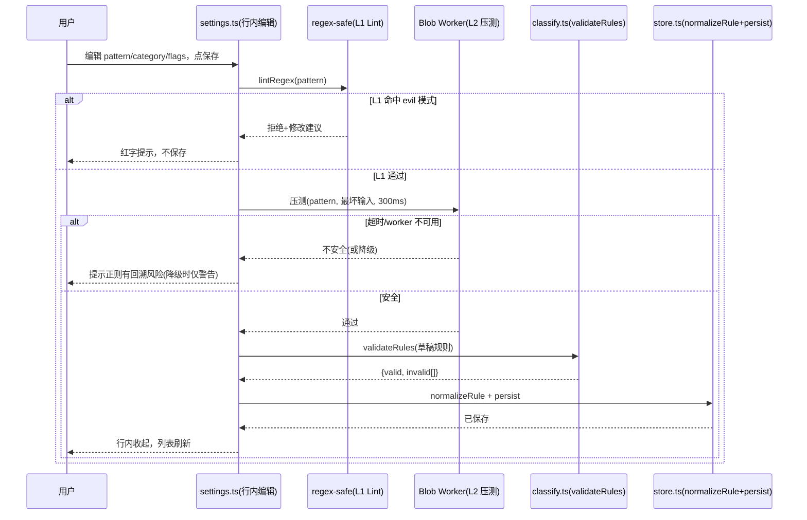
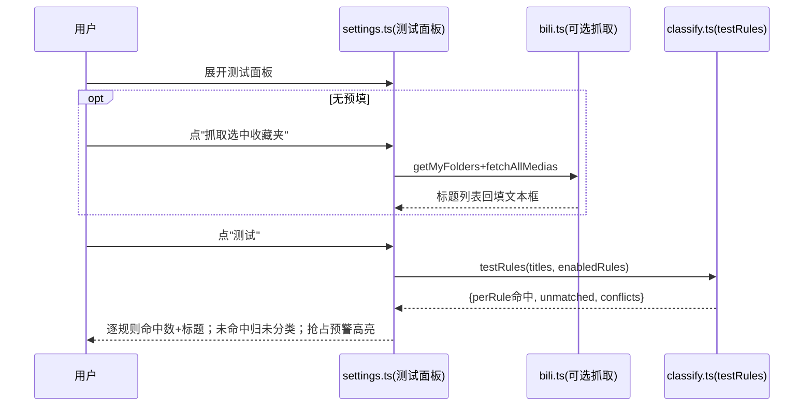
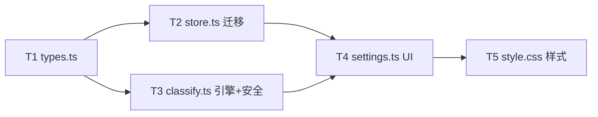

# 规则编辑功能·架构审查报告

> 审查范围：B站收藏夹整理油猴脚本的「分类规则编辑」功能链路
> 涉及文件：`src/types.ts` / `src/views/settings.ts` / `src/service/classify.ts` / `src/storage/store.ts` / `src/style.css`（必要时联动 `src/task.ts` 的只读确认）
> 审查人：架构师 Bob ｜ 日期：2026-08-21
> 硬约束：单文件油猴脚本·全内联零外部依赖·数据向后兼容·不扩 scope

---

## 一、问题清单（按角度分组，含严重度 P0/P1/P2）

> 严重度口径：**P0**=安全/数据丢失必修 ｜ **P1**=影响核心体验 ｜ **P2**=增强/可维护性
> 行号均已对照源码核实；✓=主理人诊断准确，➕=主理人遗漏的补充项。

### 1.1 易用性

| # | 问题 | 证据(行号) | 严重度 | 核实结论 |
|---|------|-----------|--------|----------|
| 1 | 用浏览器原生 `prompt`/`confirm` 三连弹（pattern→category→是否正则），移动端体验差、不能粘贴长正则 | `settings.ts:117-121` | P1 | ✓ 准确。三个原生对话框串行，iOS/部分安卓浏览器 prompt 输入框极小、长正则易被截断 |
| 2 | 只能删除不能编辑，改一条规则得删了重加 | `settings.ts:101`（仅 `data-del` 按钮，无编辑入口） | P1 | ✓ 准确 |
| 3 | 正则模式用 `confirm` 的「确定/取消」选，反直觉易误选 | `settings.ts:121-122` | P1 | ✓ 准确。点「取消」并非取消添加，而是以**关键词模式**继续添加——用户以为在取消操作，实际在创建一条非预期规则 |
| 4 | 目标分类名靠手输，易打错（游戏/游戲），无下拉选已有收藏夹 | `settings.ts:119` | P1 | ✓ 准确。**且更严重**：见 1.4 第 20 项，规则分类名在 apply 阶段是**精确字符串匹配**收藏夹名，繁简/空格差异会直接新建空夹 |
| 5 | 写完规则没法测试命中哪些视频，得跑完整整理才知道 | 全局缺失 | P1 | ✓ 准确 |
| 6 | 无规则排序、无启用/禁用开关 | `types.ts:57-63` 无 `enabled` 字段；`classify.ts:23` 遍历全部规则无跳过 | P2 | ✓ 准确 |
| ➕1 | 删除用**数组下标**定位而非稳定 `id` | `settings.ts:107` `splice(Number(dataset.del),1)`，`data-del` 来自 `map((r,i)=>...)` 的 `i` | P2 | 当前 delete-only + 每次删后重渲染尚不致错；但一旦引入「编辑/拖拽排序」，下标定位会与 organize.ts 早期同类 bug 一样错位。规则已带 `id`(uid)，应改用 id 定位 |
| ➕2 | 预览页「新建分类」「移动到新建」也用 `prompt` | `organize.ts:380,399` | P2 | 本期 scope 外，但属同一交互债，建议一并改造时统一模式（仅提示，不在本期强制） |

### 1.2 竞品对比

| # | 问题 | 竞品参照 | 严重度 | 核实结论 |
|---|------|----------|--------|----------|
| 12 | 无规则模板预设 | madoka：8 种分类模板（按 UP 主/时长/优先级） | P2 | ✓ 缺失。建议本期至少内置「按关键词」「按 UP 主」「按时长区间」3 类模板种子 |
| 13 | 无规则测试 | madoka：规则测试 | P1 | ✓ 同 #5 |
| 14 | 无启用/禁用 | madoka：规则启用禁用 | P2 | ✓ 同 #6 |
| 15 | 无 B站官方分区 tid 兜底 | jqwgt：按 tid_v2 确定性分类（零成本零幻觉） | P2 | ✓ 缺失。属未来增强项，本期不纳入（见待明确 #5） |
| 16 | 无规则单独导入/导出 | BiliShelf：事务快照；madoka：导出设置不含 Key | P2 | ✓ 现有 `exportBackup` 含全部 config（已正确剔除 apiKey），但无「仅规则」的导入导出与跨设备同步便利 |

### 1.3 安全性

| # | 问题 | 证据(行号) | 严重度 | 核实结论 |
|---|------|-----------|--------|----------|
| 7 | **ReDoS 风险**：用户输入正则无复杂度限制，`(a+)+$` 类灾难性回溯在 N视频×M规则 循环里可卡死页面 | `classify.ts:27` `new RegExp(r.pattern,'i').test(m.title)` 嵌套于 `for media × for rule` | **P0** | ✓ 准确。主线程同步执行，一次灾难性回溯即可冻结整个标签页；若发生在整理任务中，可能中断 in-flight 移动进度（虽 `appliedItems` 已幂等落盘，但 UX 上是"卡死") |
| 8 | 每条视频每条规则都 `new RegExp`，无缓存无超时 | `classify.ts:27`（循环内构造） | P2 | ✓ 准确。614 视频×5 规则≈3070 次构造，性能浪费但非致命 |
| ➕3 | **导入备份不校验规则形状**：恶意/损坏备份可注入缺字段、非字符串 pattern 的规则 | `store.ts:115-130` `parseBackup` 只对 ai/pref/folderLastRun 深合并，`rules` 直接透传 | P1 | 补充。导入后 `classify.ts:28` 对 `undefined` pattern 会抛 `TypeError`（被 `catch{}` 静默吞掉），规则形同失效；`category` 为 undefined 会产生 key `"undefined"` 的怪分类 |
| ➕4 | XSS：当前规则 pattern/category 渲染均经 `esc()` 转义 | `settings.ts:99-100`；`svg.ts:69-71` `esc` 转义 `&<>"'` | P2 | 已妥善处理。**维护性提示**：新增行内编辑/测试面板时，凡规则文本注入 DOM 必须沿用 `esc()`，标题注入属性须用 `esc()` 包裹（勿直接拼 `value="${r.pattern}"`） |

### 1.4 健壮性

| # | 问题 | 证据(行号) | 严重度 | 核实结论 |
|---|------|-----------|--------|----------|
| 9 | 非法正则 `catch{}` 静默吞错，用户不知道某条规则失效 | `classify.ts:29` `catch { /* 非法正则跳过 */ }` | P1 | ✓ 准确。添加时虽有 `new RegExp(pat,'i')` 校验(`settings.ts:124`)，但**导入备份/手改 config/旧数据**可绕过校验，运行时静默失效无任何反馈 |
| 10 | 空 pattern 使 `includes('')` 永真命中全部视频 | `classify.ts:28` `m.title.toLowerCase().includes(r.pattern.toLowerCase())`；空串 `includes('')===true` | P1 | ✓ 准确。UI 添加有 `if(!pat) return`(`settings.ts:118`) 兜底，但引擎层无防御；导入/迁移路径可产生空 pattern，会把**全部视频扫进该分类**，与「规则优先」叠加后果严重 |
| 11 | 正则 `i` flag 硬编码，用户无法控制大小写敏感 | `classify.ts:27`、`settings.ts:124` 均硬编码 `'i'` | P2 | ✓ 准确。中文标题影响小，但英文关键词(AI/MV/RGB)与正则锚点(`^A` vs `^a`)场景需可控 |
| 20 | **规则分类名不归一到已有收藏夹**：规则结果直接 merge，不经过 `matchExistingFolders`；apply 阶段又是精确字符串匹配 | `classify.ts:298-303` 规则结果直接合入 `finalResult`；`task.ts:208` `existingMap.get(cat)` 按 `f.title` 精确匹配建夹 | P1 | 补充(主理人未点出)。AI 分类在增量模式会经 `matchExistingFolders` 繁简归一(`classify.ts:241`)，**规则分类独享"特权直通"**：分类名"游戲"(繁)或"游戏 "(尾空格)不会并入已有"游戏"夹，而会**新建空夹**(若 allowAiCreate)或**被静默跳过**(`task.ts:211 continue`)。行为与 AI 不一致，是隐蔽的数据去向错误 |
| 21 | **`loadConfig` 不做单条规则迁移** | `store.ts:45` `rules: saved.rules && saved.rules.length ? saved.rules : DEFAULT_CONFIG.rules` 透传旧规则 | **P0** | 补充(数据兼容硬约束)。一旦 ClassifyRule 增字段(`enabled`/`caseSensitive`/`scope`)，旧规则这些字段为 `undefined`，`classify.ts` 直接 `r.enabled` 等访问得到 undefined→`if(!r.enabled)` 为假(等同启用，OK)但 `r.caseSensitive` 为 undefined 传给 `new RegExp(pat, undefined?'':'i')` 需谨慎——**必须**在加载/导入时按字段补默认值，否则行为不可预测 |
| 22 | `parseBackup` 不校验规则形状 | `store.ts:120-127` | P1 | 同 ➕3 |

### 1.5 可维护性

| # | 问题 | 证据(行号) | 严重度 | 核实结论 |
|---|------|-----------|--------|----------|
| 23 | 校验 flag 与运行 flag 分离，易漂移 | 添加校验 `settings.ts:124` 与运行 `classify.ts:27` 各写一遍 `'i'` | P2 | 补充。引入 `caseSensitive` 后，两处必须用同一函数计算 flags，否则"添加时校验通过、运行时报错" |
| 24 | 规则引擎缺测试钩子，无 `testRules`/`validateRules` 导出 | `classify.ts` 仅导出 `classifyByRules`（返回聚合桶，无逐条命中明细） | P2 | 补充。规则测试功能需要"哪条规则命中了哪个标题"的明细，现有签名不够，需新增纯函数 |
| 25 | 类型扩展点不足 | `ClassifyRule` 无 `scope`，匹配仅 `m.title` | P2 | 补充。UP 主名/简介匹配(madoka 有"按 UP 主")需 `scope` 字段；本期可作可选增强 |

---

## 二、改进方案（含选型理由）

### 2.1 UI 形态选型：**行内展开编辑**（非弹窗/抽屉）

**结论**：规则列表每条点击 → 原地展开为可编辑行（pattern 输入 + 目标分类下拉 + 关键词/正则切换 + 大小写开关 + 启用开关 + 上下移）；「添加规则」改为列表顶部插入一条空白可编辑行。**彻底弃用 `prompt`/`confirm`**。

**选型理由**：
1. **面板空间约束**：脚本是 560px 固定浮层(`style.css:62`)，全屏 Modal 需额外 z-index/遮罩管理，且在油猴主世界易与宿主页面弹层冲突；抽屉在小面板里无侧滑空间。行内展开零额外层级。
2. **上下文保留**：编辑一条规则时能同时看到其他规则，便于核对优先级冲突——这是规则编辑的核心心智。
3. **与现有模式一致**：`organize.ts:302` 的分类名改名已是「input + blur 保存」行内模式，规则编辑沿用同一交互范式，用户认知零成本。
4. **移动端友好**：行内 input 触发系统键盘可正常粘贴长正则，根治 #1/#3 的原生弹窗痛点（`style.css:304` 已有移动端 media query，扩展即可）。

### 2.2 正则安全方案：**静态 Lint + Blob Worker 压测**（保存时拦截）+ 运行时缓存

**结论**：分三层，保存时把灾难性正则挡在循环之外，运行时只需缓存+跳过，`classifyByRules` 保持同步、无需改调用方。

| 层 | 机制 | 时机 | 作用 |
|----|------|------|------|
| **L1 静态 Lint** | 正则源码扫描：拦截嵌套量词 `(a+)+`/`(a*)*`、重叠分支 `(a\|a)`、超长重复 `a{100,}` 等已知 evil 模式 | 添加/编辑保存时 | 零成本拦截明显灾难性正则，给出具体修改建议 |
| **L2 Blob Worker 压测**（推荐） | `new Worker(URL.createObjectURL(new Blob([code])))`，worker 内对一段构造的"最坏输入"（重复字符 + 不匹配尾）跑 `regex.test()`，主线程 `setTimeout` 超时(≈300ms)后 `terminate()` 判定不安全 | 添加/编辑保存时 | 真正的"可超时"——油猴主世界唯一能硬中断同步正则的方案；挡住 Lint 漏网的回溯炸弹 |
| **L3 运行时加固** | 模块级 `Map<string,RegExp>` 缓存编译结果(key=pattern\|flags)；`classifyByRules` 跳过 disabled/空 pattern/无效正则；保留 try/catch 但**收集 invalid 规则 id** 供 UI 红标 | 整理分类时 | 消除 N×M 重复构造(#8)；失效规则可见(#9) |

**选型理由**：
- **为何 Worker 而非纯同步**：JS 正则在主线程同步执行**无法被抢占**，一旦进入灾难性回溯，`Date.now()` 轮询也进不去。Worker 是主世界里唯一能"真超时"的手段；保存时一次性压测，运行时只跑已验证的正则，循环内无超时负担。
- **为何保存时而非运行时 Worker**：`classifyByRules` 当前是同步函数，被 `classifyAll`(async) 同步调用。若运行时每条正则都走 worker 异步，要把 `classifyByRules` 改成 async 并重构两处调用点——超 scope 且增加整理耗时。保存时压测把风险前置，运行时保持同步最简。
- **CSP 降级**：B站可能下发严格 CSP 拦截 `blob:` worker。`new Worker(blobUrl)` 失败时 catch → 降级到「仅 L1 静态 Lint + 运行时 try/catch」，并向用户 toast 提示"正则安全校验降级"。可用性优先于绝对安全。
- **Worker 代码零外部依赖**：worker 源码以字符串内联在脚本里，经 Blob 构造，不引入任何 CDN/文件，符合"全内联"铁律。

### 2.3 规则测试方案：**行内测试面板**（双数据源 + 逐条命中明细 + 优先级抢占预警）

**结论**：规则卡片底部加可折叠「测试规则」面板：
- **数据源**（二选一，默认预填）：
  - A. 文本框：默认从 `state.task?.medias`（最近一次整理抓到的视频标题）预填，无任务则空+占位提示"每行一个标题"；
  - B. 「抓取选中收藏夹」按钮：若 `state.selectedFolders` 有选中夹，调 `getMyFolders`+`fetchAllMedias` 取标题回填（复用 `bili.ts`，节流风控已有）。
- **执行**：调新增的 `testRules(titles: string[], rules: ClassifyRule[])`（纯函数，`classify.ts` 导出），返回 `{ perRule: {ruleId, hitTitles[]}[], unmatched: string[], conflicts: {title, earlyRule, lateRule}[] }`。
- **展示**：每条启用规则显示命中数+命中标题列表(折叠)；未命中标题归"将送 AI / 未分类"；**优先级抢占预警**——若某标题被靠前的宽规则命中、靠后的窄规则本也匹配，高亮提示"规则 X 抢占了规则 Y 的潜在命中"，引导用户调整顺序或收窄前置规则。
- **复用引擎**：`testRules` 与 `classifyByRules` 共用同一「匹配判定」内核（提取为 `matchOne(rule, media)` 纯函数），保证测试结果与真实分类一致，杜绝"测试通过、整理却不同"。

### 2.4 数据结构变更与向后兼容迁移

**ClassifyRule 扩展**（`types.ts`）：
```ts
export type RuleScope = 'title' | 'title_intro' | 'upper';

export interface ClassifyRule {
  id: string;
  pattern: string;
  category: string;
  isRegex: boolean;
  enabled: boolean;        // 新增，默认 true
  caseSensitive: boolean;  // 新增，默认 false（保持原 'i' 行为，向后兼容）
  scope?: RuleScope;       // 新增可选，默认 'title'（保持原仅匹配 title 行为）
}
```

**迁移策略**（`store.ts` 的 `loadConfig` 与 `parseBackup` 共用 `normalizeRule()`）：
```ts
function normalizeRule(r: any, fallbackId: string): ClassifyRule {
  const pattern = typeof r?.pattern === 'string' ? r.pattern : '';
  return {
    id: typeof r?.id === 'string' ? r.id : fallbackId,
    pattern,
    category: typeof r?.category === 'string' ? r.category : '',
    isRegex: !!r?.isRegex,
    enabled: typeof r?.enabled === 'boolean' ? r.enabled : (pattern ? true : false), // 空 pattern 默认禁用，避免 #10 永真
    caseSensitive: !!r?.caseSensitive,
    scope: r?.scope === 'title_intro' || r?.scope === 'upper' ? r.scope : 'title',
  };
}
```
- 旧规则无新字段 → 补默认值，**零数据丢失**。
- 空 pattern 规则 → `enabled:false`（不删用户数据，但默认不生效，杜绝 #10 全量误命中），UI 红标提示"空规则已禁用"。
- 备份 `version` 升至 2，`parseBackup` 兼容 v1（按字段补默认）；导出格式不变(仍含 rules 全字段)。
- **flag 统一**：新增 `ruleFlags(r): string`（`r.caseSensitive ? '' : 'i'`），校验(`settings.ts`)与运行(`classify.ts`)共用，消除 #23 漂移。

### 2.5 关键流程（Mermaid）

**保存正则规则（含安全校验）**：


**规则测试**：


---

## 三、任务分解（表格）

> 按"数据层→引擎层→安全层→表现层→样式层"排序，逐层依赖；每行一个可独立交付的任务。

| 序号 | 文件 | 改动要点 | 依赖 | 优先级 |
|------|------|----------|------|--------|
| T1 | `src/types.ts` | 扩展 `ClassifyRule`：新增 `enabled`、`caseSensitive`、`scope?:RuleScope`；新增 `RuleScope` 类型(`'title'\|'title_intro'\|'upper'`)。保持字段向后兼容(全可选/带默认) | — | P0 |
| T2 | `src/storage/store.ts` | ① 新增 `normalizeRule()` 归一化单条规则(补默认值/空pattern→disabled/类型校验)；② `loadConfig` 与 `parseBackup` 对 `rules` 逐条 `normalizeRule`，替代当前整段透传(`store.ts:45`、`store.ts:120-127`)；③ `DEFAULT_CONFIG.rules` 补 `enabled:true/caseSensitive:false/scope:'title'`；④ 备份 `version`→2，parser 兼容 v1 | T1 | P0 |
| T3 | `src/service/classify.ts` | ① 抽取 `matchOne(rule, media)` 纯函数(按 `scope` 取 title/intro/upper，按 `caseSensitive` 算 flags)；② `classifyByRules` 改用 `matchOne`，**跳过 disabled/空 pattern**，**缓存 RegExp**(模块级 Map)，catch 时**收集 invalid 规则 id** 返回；③ 新增 `ruleFlags(r)` 供校验/运行共用；④ 新增 `validateRules(rules):{valid,invalid[]}`；⑤ 新增 `testRules(titles,rules):{perRule,unmatched,conflicts}` 供测试面板调用；⑥ **ReDoS 安全**：内置 `lintRegex()`(L1 静态扫描嵌套量词等)+ `stressTestRegex()`(L2 Blob Worker 压测带 300ms 超时，CSP 失败降级 L1)，在 `validateRules` 中对 isRegex 规则调用 | T1 | P0 |
| T4 | `src/views/settings.ts` | ① **弃用 prompt/confirm**：规则列表改行内展开编辑(点击展开→pattern 输入+目标分类下拉+关键词/正则切换+大小写开关+启用开关+上下移+保存/取消)；「添加规则」改为顶部插入空白可编辑行；② 目标分类下拉调 `getMyFolders()` 取已有收藏夹名，保留"自定义新名"兜底；③ 删除/定位改用规则 `id`(非下标)；④ 规则列表对 `validateRules` 返回的 invalid 规则红标+错误说明；⑤ 新增「测试规则」折叠面板(文本框预填 `state.task?.medias` 标题 + "抓取选中夹"按钮 + 调 `testRules` 展示命中/未命中/抢占预警)；⑥ 保存正则规则前调 `lintRegex`+`stressTestRegex` 拦截 | T1,T2,T3 | P1 |
| T5 | `src/style.css` | ① 新增行内编辑态样式：`.wb-rule-edit`/`.wb-rule-row`/`.wb-rule-flag`(关键词/正则切换)/`.wb-rule-toggle-mini`(大小写·启用)/`.wb-rule-move`(上下移)；② 新增测试面板样式：`.wb-rule-test`/`.wb-rule-test-in`/`.wb-rule-hit`/`.wb-rule-conflict`(抢占预警高亮)；③ invalid 规则红标 `.wb-rule-invalid`；④ 移动端适配(扩 `@media max-width:640px`，行内编辑行换行/按钮足够大) | T4 | P1 |

**任务依赖图**：


> 说明：T2 与 T3 均仅依赖 T1，可并行；T4 汇聚 T1/T2/T3；T5 收尾。整体为"数据→引擎→表现→样式"的线性分层，无循环依赖。

---

## 四、待明确事项

1. **规则测试数据源默认策略**：默认用 `state.task?.medias`（最近一次整理）的标题预填，还是强制用户手输/点"抓取"？后者更干净但多一步操作。需主理人定。倾向：**有任务则预填，无则空+引导**。

2. **`caseSensitive` / `scope` 是否纳入首版**：最小改动可只做 `enabled`(直接解 #6/#9)。`caseSensitive` 解 #11、`scope` 对标 madoka「按 UP 主」。两者都会加宽 T1~T4 改动面。需主理人确认首版范围。倾向：**`enabled`+`caseSensitive` 必做(P0/P1 直击诊断)，`scope` 列为可选增强(P2)**。

3. **Blob Worker 在 B站 CSP 下可用性**：需在真机(登录态下 www.bilibili.com)验证 `new Worker(blobUrl)` 是否被 CSP 拦截。若被拦，是否接受"仅 L1 静态 Lint + 运行时 try/catch"的降级方案？这决定 L2 是否值得投入。倾向：**先验 CSP，不可用则降级并 toast 明示**。

4. **规则排序交互形态**：拖拽排序 vs 上下箭头按钮？拖拽在移动端体验差且需手写 drag 逻辑(零依赖约束下不能用 dnd 库)。倾向：**上下箭头按钮**（移动端友好、实现简单、无依赖）。

5. **是否引入 B站官方分区 tid 兜底**（jqwgt 方案）：作为"无 AI 无规则命中"时的确定性分类，零幻觉零成本。但需新增 tid 抓取与映射表，超出当前"规则编辑"scope。倾向：**本期不纳入，列为下一期独立增强**，需主理人确认。

6. **规则目标分类下拉是否允许"新建收藏夹名"**：现 `allowAiCreate` 控制 AI 新建夹；规则侧若用户在下拉选"自定义新名"，是否同样受 `allowAiCreate` 约束（apply 时 `task.ts:211` 已有该开关判断）？倾向：**一致受控**，下拉中"自定义新名"在 `allowAiCreate=false` 时置灰并提示。

7. **规则分类名是否应纳入繁简归一**：#20 的根因是规则结果直通、apply 精确匹配。是否在 apply 阶段对规则分类名也走 `matchExistingFolders`？这会改变"规则=用户显式意图、不归并"的现有语义(`classify.ts:298` 注释)。倾向：**不在 apply 改语义，而在编辑端用下拉强制选已有夹**（从源头消除错名），保留规则直通特权。需主理人确认是否接受这一折中。
